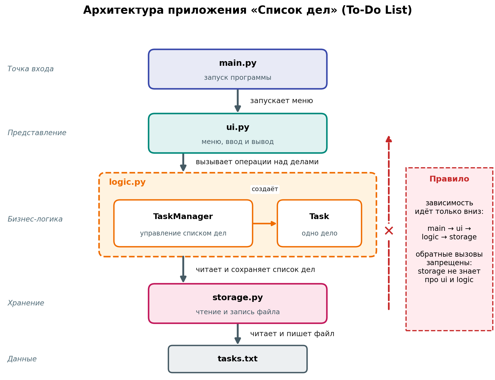

# Архитектура: Список дел (To-Do List)

## Функциональные требования
1. Добавить дело (название, срок выполнения).
2. Вывести список всех дел с отметкой статуса (выполнено / не выполнено).
3. Отметить дело выполненным.
4. Удалить дело.
5. Сохранять список дел между запусками программы.

## Компоненты
- main.py - точка входа: запускает меню приложения.
- ui.py - слой представления: меню, ввод данных и вывод списка дел. Не содержит правил работы с делами.
- logic.py - бизнес-логика: класс Task описывает одно дело (название, срок, статус), класс TaskManager отвечает за добавление, отметку выполнения и удаление дел.
- storage.py - слой хранения: чтение и запись списка дел в файл tasks.txt.

## Связи
main.py запускает ui.py.
ui.py обращается к logic.py.
logic.py читает и сохраняет данные через storage.py.
Обратные вызовы запрещены: storage не знает о ui и logic.

## Схема

